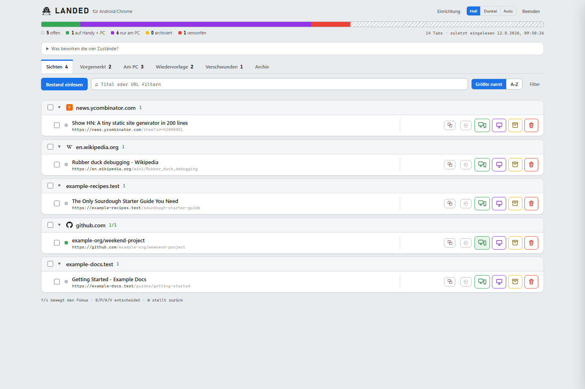
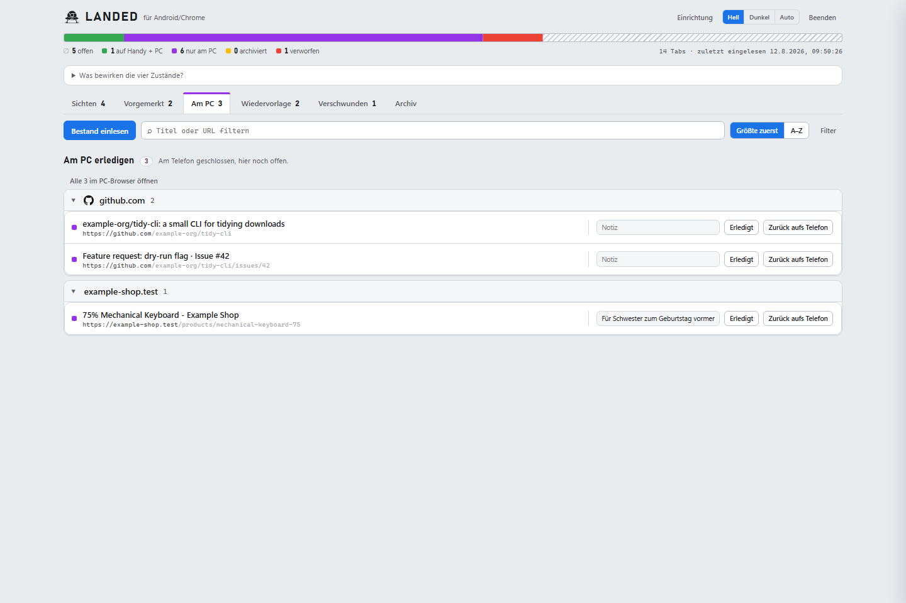
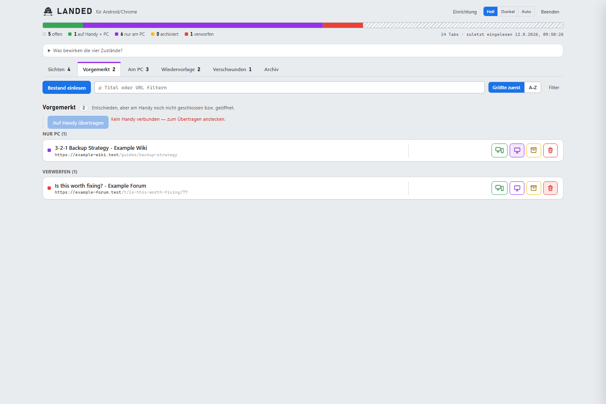
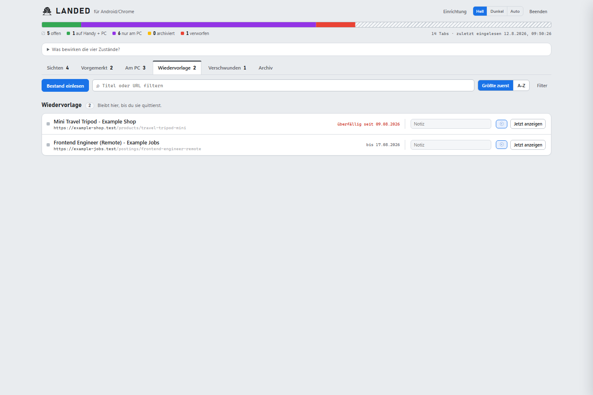
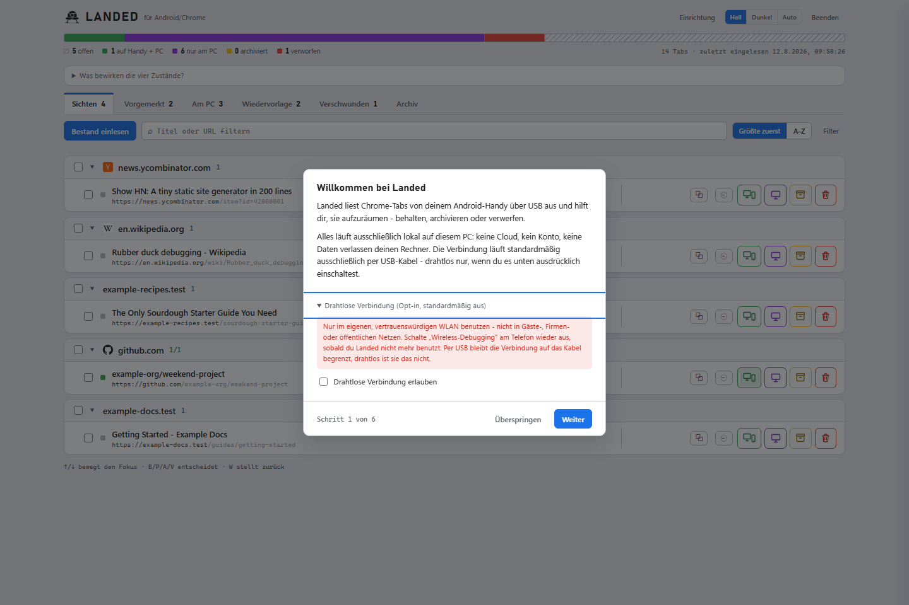
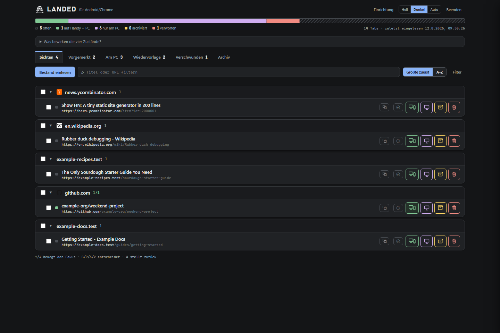

*[English version](README.md)*

<p align="center">
  
</p>

<h1 align="center">Landed — for Android/Chrome</h1>

<p align="center">
  Holt die Tabs, die eigentlich "noch am PC gemacht werden müssen", vom Handy auf den PC:
  einlesen, sichten, gruppieren, entscheiden, zurückschreiben. Läuft ausschließlich lokal,
  kein Cloud-Dienst, keine Dependencies.
</p>

<p align="center">
  Kostenlos und Open Source unter der <a href="LICENSE">MIT-Lizenz</a>. Spart es dir Zeit? ☕ <a href="https://buymeacoffee.com/workbenchdigital">Buy Me a Coffee</a> — freiwillig, kein Feature-Unlock.
</p>

## Screenshots

*(Alle Screenshots zeigen erfundene Beispieldaten, keinen echten Tab-Bestand.)*

| Sichten — nach Domain gruppiert, mit Filter und Suche | Am PC — dieselbe Filter-/Gruppierlogik jetzt überall |
|---|---|
|  |  |

| Vorgemerkt — entschieden, am Handy noch nicht geschlossen | Wiedervorlage — fällig/überfällig klar markiert |
|---|---|
|  |  |

| Drahtlose Verbindung — Opt-in, standardmäßig aus | Dunkelmodus |
|---|---|
|  |  |

## Voraussetzungen

**Als `Landed.exe` (Release-ZIP):** nur ein Android-Gerät mit aktiviertem
USB-Debugging, per USB verbunden. Node und die Android Platform-Tools (`adb`)
sind in der `.exe` bzw. im `platform-tools\`-Ordner daneben bereits enthalten
— nichts zu installieren.

**Aus dem Quellcode:**
- Node.js 22+ (getestet mit v26 — braucht eingebautes `fetch` und `WebSocket`)
- `adb` (Android Platform-Tools) im PATH, oder Pfad über `ADB_PATH` setzen
- Android-Gerät mit aktiviertem USB-Debugging, per USB verbunden

## Tägliche Nutzung

**Aus dem Quellcode (aktuell):** `npm start` (bzw. `node server.mjs`), dann
`http://127.0.0.1:7890` im Browser öffnen. Beenden über den „Beenden"-Knopf
im Header oder `Strg+C` im Terminal.

**Als paketierte App (`Landed.exe`, `npm run build`):** Doppelklick öffnet
Server + eigenständiges App-Fenster automatisch (kein Terminal-Fenster,
kein separates Start-Skript mehr nötig). Ein zweiter Doppelklick bei
bereits laufender Instanz öffnet nur ein weiteres Fenster, startet nichts
doppelt. Beenden über den „Beenden"-Knopf im Header oder `Landed.exe --stop`.
Eine Desktop-Verknüpfung lässt sich über den Einrichtungsassistenten
anlegen (serverseitig, kein separates VBS-Skript mehr).

## Ablauf

1. **Erster Start:** Der Einrichtungsassistent öffnet sich automatisch, wenn
   noch keine Einrichtung abgeschlossen ist. Er führt live (per Polling gegen
   `POST /api/health`) durch USB-Debugging aktivieren, Kabel verbinden,
   Autorisierungsdialog bestätigen und Chromes Tab-Declutter deaktivieren
   (siehe „Bekannte Grenzen" unten) — jeder Schritt hat zusätzlich einen
   manuellen „Weiter"-Knopf. Überspringen zählt als abgeschlossen; über den
   „Einrichtung"-Knopf im Header jederzeit erneut aufrufbar.
2. **App starten** über die Desktop-Verknüpfung (aus dem Assistenten anlegbar)
   oder Doppelklick auf `Landed.exe`, bzw. aus dem Quellcode mit `npm start`.
   Browser öffnet sich automatisch bei der paketierten App, sonst manuell
   `http://127.0.0.1:7890` aufrufen.
3. **„Bestand einlesen"** klicken — liest alle aktiven Tabs über CDP
   (`/json/list`), merged sie in den bestehenden Bestand (kein Ersetzen —
   verschwundene Tabs werden nicht sofort als „weg" gewertet, siehe unten),
   gruppiert nach Domain, dedupliziert nach normalisierter URL.
4. Pro Tab oder pro Domain-Gruppe entscheiden — jede Option sagt, wo der Link
   danach liegt, nicht nur welche Aktion sie auslöst (die Legende in der App
   erklärt jede Option ausführlicher):
   - **Handy + PC (B)** — Tab bleibt am Handy offen, Link bleibt in „Sichten".
   - **Nur PC (P)** — Tab wird am Handy geschlossen, bleibt aber als eigene
     Arbeitsliste „Am PC erledigen" in der App bestehen (Notiz, Wiedervorlage,
     „erledigt"/„zurück aufs Telefon").
   - **Archiv (A)** — Tab wird am Handy geschlossen, bleibt aber dauerhaft
     durchsuchbar im Archiv.
   - **Verwerfen (V)** — Tab wird am Handy geschlossen, bleibt gespeichert,
     aber nur zur Wiedererkennung (↺-Badge bei erneutem Auftauchen) — in der
     Archivsuche per Default ausgeblendet, Schalter „auch Verworfene zeigen"
     blendet sie ein.
   Buttons oder Tastaturkürzel B/P/A/V auf der fokussierten Zeile, ↑/↓ zum
   Wandern. Die Sortierleiste oben zeigt den Fortschritt über den ganzen Bestand.
   Entschiedene Tabs (außer „Handy + PC" — die bleiben ja sichtbar) verschwinden
   sofort aus „Sichten" in den Reiter „Vorgemerkt".
5. **Reiter „Vorgemerkt"** — alle entschiedenen Tabs, die am Handy noch offen
   sind, nach Entscheidung gruppiert. Ein Knopf **„Auf Handy übertragen"**
   schließt die zum Schließen vorgemerkten Tabs UND öffnet „Handy + PC"-Tabs,
   die dort noch fehlen, in einem Schritt (deckt sich mit der alten
   „Behaltene öffnen"/„Vorgemerkte schließen"-Kombination). Ohne verbundenes
   Handy ist der Knopf deaktiviert statt eine Fehlermeldung erst nach dem
   Klick zu zeigen. Vor dem Schließen wird automatisch ein Snapshot des
   aktuellen Bestands nach `backups/` geschrieben.
6. **Mehrfachauswahl** — Checkbox je Zeile bzw. „alle in dieser Gruppe";
   ausgewählte Tabs lassen sich gemeinsam entscheiden, kopieren
   (`navigator.clipboard`) oder als Markdown-Liste bzw. Netscape-
   Lesezeichendatei exportieren.

**Wiedervorlage:** ⏰-Knopf öffnet ein Datums-Schnellmenü (Morgen/Nächste
Woche/Monat/Datum wählen). Aus „Sichten" bringt ein Datum den Tab zusätzlich
in „Nur PC" (Wiedervorlage = „Nur PC" + Datum, kein eigener Zustand); bei
bereits entschiedenen Tabs ändert sich nur das Datum — bestehende Aufgaben
lassen sich so vertagen. Zurückgestellte Tabs verschwinden aus allen anderen
Listen, bleiben aber im eigenen Bereich „Wiedervorlage" sichtbar — auch nach
Fälligkeit (fällig/überfällig deutlich markiert, nach Datum sortiert), bis sie
über „Jetzt anzeigen" bewusst quittiert werden. Ein Banner beim Öffnen der App
weist auf Fälliges hin.

**Archiv-Suche:** das zweite Suchfeld in der Werkzeugleiste durchsucht das
komplette Archiv (Titel, URL und Notiz; auch bereits erledigte Tabs), nicht
nur den aktuell eingelesenen Bestand. Verworfene Tabs sind per Default
ausgeblendet (Schalter „auch Verworfene zeigen" blendet sie ein).

**Mehrere Geräte:** taucht mehr als ein verbundenes Gerät auf, zeigt
der Header einen Umschalter (sonst unsichtbar, kein zusätzlicher Klick im
Ein-Geräte-Regelfall). Jedes Gerät bekommt seinen eigenen Bestand unter
`devices/<seriennummer>/` und lässt sich über den Stift-Knopf daneben
umbenennen. Es läuft dabei immer nur eine ADB-Sitzung gegen genau ein
aktives Gerät gleichzeitig — kein paralleles Fernsteuern zweier Handys.

**Drahtlose Verbindung (Opt-in, standardmäßig AUS):** Landed arbeitet im
Auslieferungszustand ausschließlich über USB. Wer will, kann im
Einrichtungsassistenten unter „Drahtlose Verbindung" den Schalter umlegen —
erst dann akzeptiert Landed überhaupt drahtlos verbundene Geräte, und erst
dann sind die Endpunkte zum Koppeln/Verbinden nutzbar. Genutzt wird
ausschließlich der moderne Android-11+-Weg: einmalig `adb pair <ip:port>
<code>` mit dem 6-stelligen Code aus `Entwickleroptionen → Wireless-Debugging
→ Gerät mit Kopplungscode koppeln` (TLS-authentifiziert), danach `adb connect
<ip:port>`. IP, Port und Code werden von Hand eingetippt — kein mDNS-Scan, kein
automatisches Verbinden. Der Code ist einmalig und wird von Landed nirgends
gespeichert; den ausgetauschten Schlüssel verwaltet `adb` selbst. Gemerkt wird
nur die zuletzt verbundene `ip:port`, um das Feld vorzubelegen.

Der Trade-off, den man damit bewusst eingeht: eine USB-Verbindung endet am
Kabel, eine drahtlose ist im ganzen WLAN sichtbar. Deshalb nur im eigenen,
vertrauenswürdigen Netz benutzen — nicht in Gäste-, Firmen- oder öffentlichen
WLANs — und „Wireless-Debugging" am Telefon wieder ausschalten, sobald es nicht
gebraucht wird.

**Nicht implementiert und bewusst nicht vorgesehen:** der alte
`adb tcpip <port>`-Modus. Der lässt das Telefon nach dem Trennen
unauthentifiziert für jedes Gerät im selben WLAN offen — eine eigene,
ältere Klasse von Wireless-ADB-Risiko, die Landed vollständig vermeidet,
indem es dafür gar keinen Bedienweg bietet.

Sicherheitspatch lässt sich jederzeit manuell prüfen:
```
adb shell getprop ro.build.version.security_patch
```
Sollte `2026-05-01` oder neuer sein. CVE-2026-0073 ist eine kritische
(CVSS 9.8), Zero-Click-Authentifizierungsumgehung in `adbd`s eigener
TLS-Zertifikatsprüfung (ein Logikfehler in `adbd_tls_verify_cert`) — sie
betrifft den *modernen* Pairing-Flow, den Landeds Opt-in tatsächlich nutzt,
nicht nur den alten `tcpip`-Weg. Gepatchte Versionen (2026-05-01 oder neuer)
beheben die Prüflogik selbst. Auf einem ungepatchten Telefon bleibt das
Einschalten von Wireless-Debugging riskant, unabhängig davon, welches
Werkzeug die Verbindung aufbaut — Landeds TLS-Pairing-only-Design hält die
Verbindung von der älteren, unauthentifizierten Angriffsfläche fern, macht
ein ungepatchtes Gerät aber nicht von allein sicher. Patchstand *vor* dem
Einschalten des Opt-in prüfen, nicht danach. Der Einrichtungsassistent zeigt
ihn zur Orientierung auf der letzten Seite an.

## Sicherheit

- Server bindet ausschließlich an `127.0.0.1` — kein Netzwerk-Exposure.
- USB-ADB im Standardzustand. Drahtlose Verbindungen nur nach ausdrücklichem
  Opt-in in den Einstellungen, und dann ausschließlich über den
  TLS-Pairing-Flow (`adb pair` + `adb connect`) — nie über `adb tcpip`.
- Das schützt für sich genommen **nicht** vor CVE-2026-0073 — die liegt in
  genau der TLS-Prüfung, auf die sich `adb pair`/`adb connect` verlassen.
  Nur der Patchstand des Geräts schützt davor (siehe oben) — vor dem
  Einschalten des Opt-in prüfen.
- Der Pairing-Code wird nur an `adb` durchgereicht und nie gespeichert.
  IP/Port/Code werden vor jedem `adb`-Aufruf gegen ein striktes Muster geprüft.
- Port-Forwarding (`tcp:9222`) wird nach jeder Operation automatisch entfernt und
  verifiziert (auch bei Absturz/Ctrl+C via Cleanup-Handler).
- USB-Debugging (und ggf. Wireless-Debugging) nach der Session am Gerät wieder deaktivieren, wenn es nicht
  dauerhaft gebraucht wird.

## Bekannte Grenzen (Stand 07.08.2026, empirisch getestet)

- **Deckung ist NICHT robust gegenüber Chromes „Tab Declutter"-Feature (Android) —
  Ursache durch Webrecherche vom 08.08.2026 bestätigt, nicht nur vermutet.**
  Ursprünglich wurde ein Rückgang nach einem `adb shell am force-stop
  com.android.chrome` + Neustart beobachtet (255 → 143 Tabs, −43 %, stabil
  über mehrere Minuten/Scans). Ein späterer Live-Test an einem reelen Bestand
  bestätigte exakt: CDP fand 159 Tabs, während das Gerät 159 aktive + 115
  „inaktive" Tabs auswies — die Differenz deckt sich exakt. Root Cause: Chrome
  für Android verschiebt Tabs nach Inaktivität (Standard 7 Tage, einstellbar)
  automatisch in eine separate „Inaktive Tabs"-Sektion und speichert sie dort
  nur noch als minimale Metadaten (URL+Titel) im lokalen Storage — **nicht
  mehr als laufenden Renderer-Prozess mit CDP-Target.** Das ist strukturell,
  nicht vorübergehend: `/json/list` und auch das rohe `Target.getTargets` über
  den Browser-WebSocket (mit und ohne `setDiscoverTargets`) sehen diese Tabs
  nie, weil sie schlicht nicht im CDP-Target-Modell existieren. Nach 60–90
  Tagen Inaktivität schließt Chrome sie zusätzlich automatisch ganz.
  **Schutzmaßnahme:** Das Tool warnt automatisch beim Scan, wenn die
  gefundene Tabzahl signifikant (>15 %) unter dem letzten bekannten Stand liegt.
  **Empfehlung zur Vermeidung:** `Chrome-Einstellungen → Erweitert → Tabs und
  Tabgruppen → In inaktiven Bereich verschieben → Nie` setzen — verhindert,
  dass Tabs überhaupt in diesen für CDP unsichtbaren Zustand wandern.
- Als Konsequenz daraus: Ist ein Tab (noch) nicht sichtbar, bleibt sein
  gespeicherter Zustand (`keep`/`pc`/`archive`/`drop`) in `items.json`
  unverändert erhalten — der Scan rät nie, sondern trägt nur `missingSince`/
  `missedScans` ein und zeigt den Tab im Bereich „Nicht mehr auffindbar" an,
  sobald er mehrfach in Folge fehlt. Kein Datenverlust, keine verlorene
  Entscheidung; bei Wiederauftauchen verschwindet der Eintrag aus diesem
  Bereich automatisch wieder.
- Ein echter Fallback (Abgleich gegen einen Lesezeichen-Export der Tab-Liste,
  der auch inaktive Tabs erfasst) ist im Backend vorhanden
  (`lib/bookmarks.mjs`, `/api/bookmark-*`-Endpunkte), aber bewusst nicht in
  der Oberfläche verdrahtet — der manuelle Schritt am Telefon (zusätzlich
  einmal in „Inaktive Tabs" wechseln und dort erneut Lesezeichen für Tabs
  ausführen, da „Alle auswählen" die beiden Bereiche vermutlich nicht
  gemeinsam erfasst) wurde als zu umständlich für den regulären Workflow
  eingestuft.
- `PUT /json/new` (HTTP-Endpoint zum Öffnen neuer Tabs) funktioniert auf dem
  Testgerät nicht („Could not create new page"). Das Tool nutzt deshalb
  ausschließlich `Target.createTarget`/`Target.closeTarget` über den
  Browser-WebSocket — das ist getestet und funktioniert zuverlässig.
- „Inaktive Elemente automatisch schließen" in den Chrome-Einstellungen sollte
  ausgeschaltet sein — Chrome löscht sonst nach 6 Monaten inaktive Tabs selbständig.
- **Mehrfach geöffnete identische URLs werden beim Einlesen zu einem Eintrag
  zusammengeführt** (sichtbar am „×3"-Badge in der Liste). „Auf Handy
  übertragen" öffnet einen „Handy + PC"-Tab deshalb nur, wenn er am Handy
  gerade nicht schon lebt (per frischer Tab-Liste gegen `normalizeUrl`
  geprüft) — sonst entstünde bei jedem Übertragen ein weiteres Duplikat.

## Dateien

```
server.mjs                     HTTP-Server (node:http), bindet nur 127.0.0.1, Routing-Tabelle
lib/config.mjs                 Einzige Quelle fuer Ports, Pfade, Stellschrauben
lib/adb.mjs                    ADB-Session: Port-Forwarding auf/ab, Refcounting, Cleanup-Handler
lib/cdp.mjs                    CDP-Client: /json/list lesen, Tabs öffnen/schließen per WebSocket
lib/items.mjs                  Item-Store: SQLite (node:sqlite) je Geraet, Merge-Scan, Archiv
lib/store.mjs                  URL-Normalisierung, Backup-Snapshots
lib/health.mjs                 POST /api/health - Sondenkette adb -> Geraet -> Forward -> Chrome
lib/settings.mjs               settings.json - Einrichtungsstatus
lib/errors.mjs                 Uebersetzt rohe ADB/CDP-Fehler in verstaendliche Meldungen
lib/bookmarks.mjs              Liest Chrome-Bookmarks-Datei fuer den Vollstaendigkeits-Abgleich
lib/launcher.mjs               Windows-Launcher: Chrome/Edge per Registry finden,
                                App-Fenster öffnen, Desktop-Verknüpfung anlegen
public/                        Triage-Oberfläche (Vanilla HTML/CSS/JS, keine Frameworks)
public/wizard.js               Einrichtungsassistent (natives <dialog>, Live-Erkennung)
public/shared/decisions.mjs    Entscheidungs-Vokabular - eine Quelle fuer Server und Browser
tools/build.mjs                Baut Landed.exe (esbuild-Bundle + node --build-sea + Icon/Subsystem)
tools/make-icon.mjs            Erzeugt assets/landed.ico aus dem App-Icon-Design
tools/fetch-platform-tools.mjs Laedt die Android-Platform-Tools fuer den Build (einmalig, gecacht)
tools/migrate-v2.mjs           Einmalige Migration vom Vor-Stufe-2-Datenmodell (inventory/decisions/archive.md)
```

Nutzerdaten liegen **nicht** neben dem Quellcode, sondern in
`%LOCALAPPDATA%\Landed\` (überschreibbar via `LANDED_DATA_DIR`) — ein
Installationsverzeichnis ist bei einer paketierten App nicht beschreibbar.
Beim ersten Start werden vorhandene Altdaten aus einem `data/`-Ordner neben
dem Quellcode einmalig automatisch übernommen.

```
landed.db                      SQLite (node:sqlite, Node-Builtin - kein npm-Paket):
  Tabelle items                 Arbeitsliste je Geraet: alles Nicht-Terminale
                                (open/keep/pc/archive/drop, jeweils mit
                                snoozeUntil/missingSince/missedScans/note)
  Tabelle meta                  Geraete-Label, Zeitpunkt des letzten Scans
  Tabelle archive               Geraeteuebergreifend: archivierte, verworfene
                                und erledigte ("done") Tabs
backups/                       Snapshots vor jeder Schreiboperation (bewusst
                                Klartext-JSON: von Hand inspizierbar)
settings.json                  Einrichtungsstatus (setupCompletedAt/-Version/-Weg)
```

Bis Version 0.1.0 lagen Items, Meta und Archiv als `devices/<serial>/items.json`,
`devices/<serial>/meta.json` und `archive.jsonl` auf der Platte. Beim ersten
Start uebernimmt `lib/items.mjs` einen solchen Bestand automatisch nach
`landed.db` — einmalig, nur solange die Datenbank noch leer ist, und ohne die
Altdateien anzufassen. Ein zweiter Start uebernimmt nichts erneut.

Kein PID-File mehr (Einzelinstanz-Erkennung läuft über `EADDRINUSE` +
Selbstcheck, siehe `server.mjs`), keine feste `server.log` mehr (Ausgabe
läuft direkt im Terminal bzw. bei der paketierten App ins Windows-eigene
Prozess-Handling).

Bei einer bestehenden Installation mit dem alten Datenmodell (`inventory.json`/
`decisions.json`/`archive.md`) einmalig migrieren: `node tools/migrate-v2.mjs`
(Dry-Run per Default, `--write` zum tatsächlichen Ausführen).
