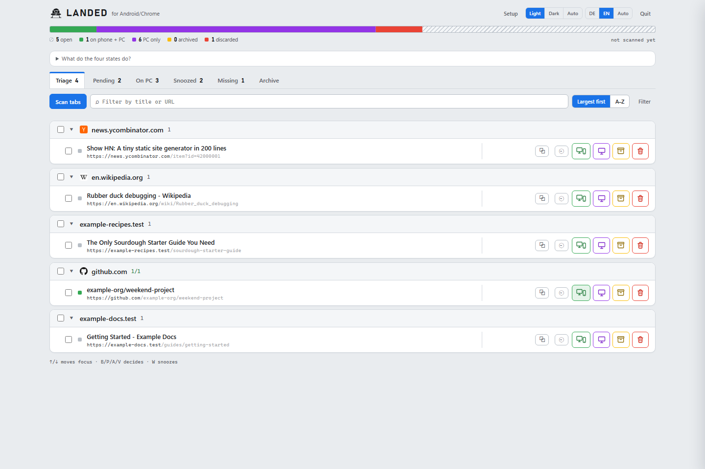
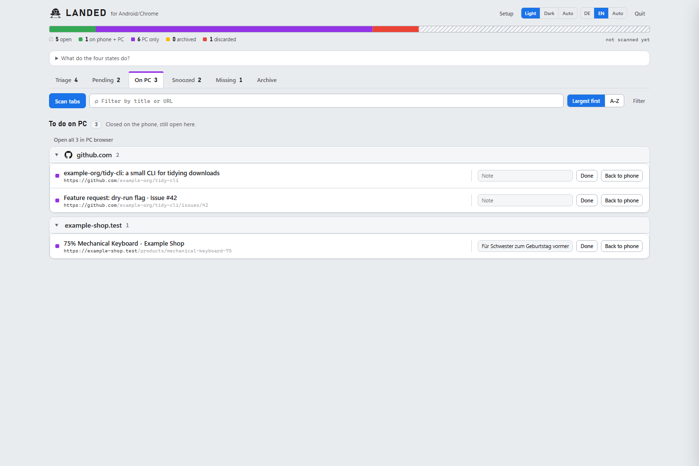
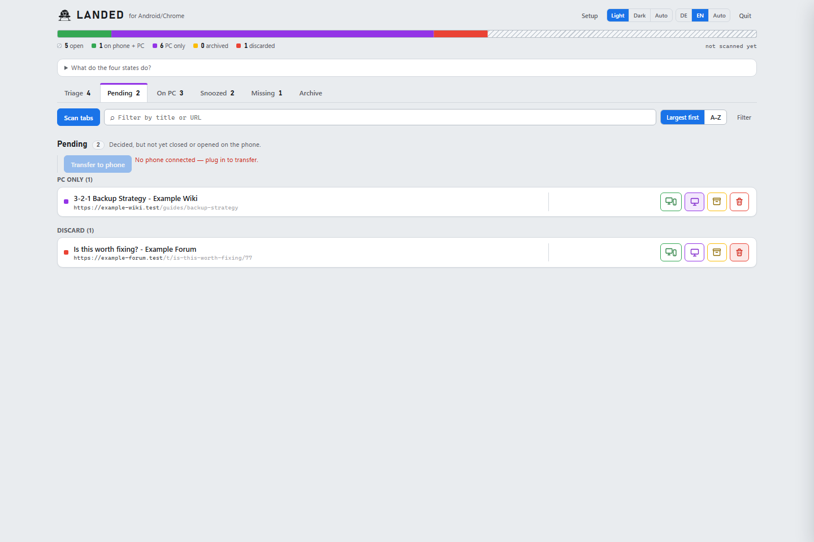
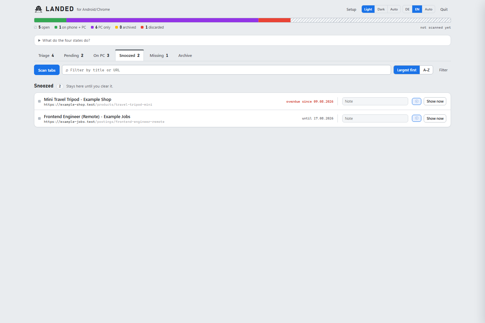
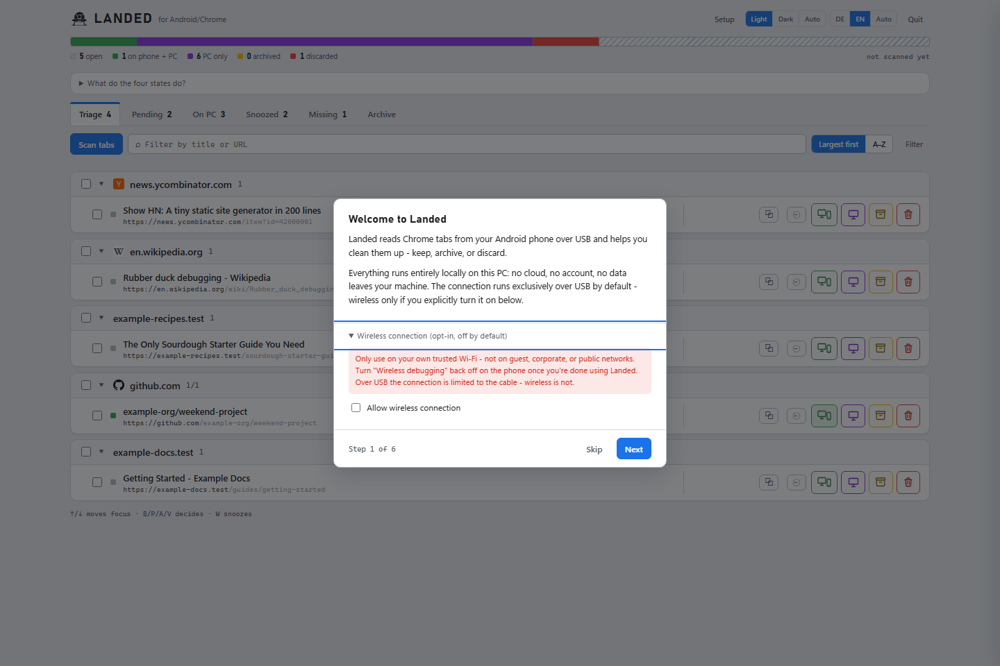
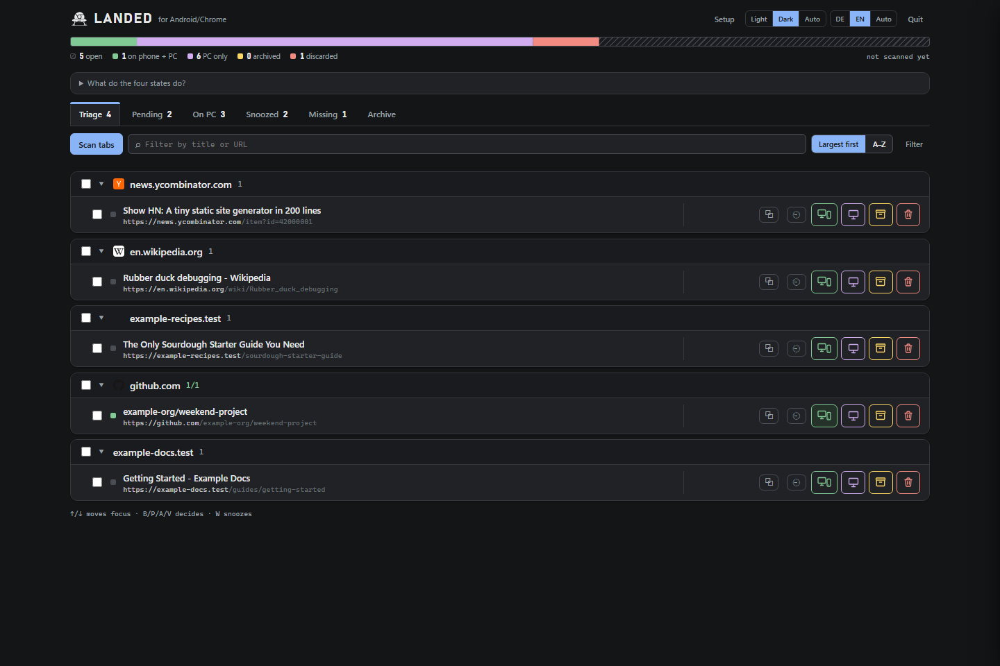

*[Deutsche Version](README.de.md)*

<p align="center">
  
</p>

<h1 align="center">Landed — for Android/Chrome</h1>

<p align="center">
  Pulls the tabs you keep telling yourself you'll "deal with on the computer" from your phone to your PC:
  read them in, sort them, decide, write the result back. Runs entirely locally — no cloud service, no dependencies.
</p>

<p align="center">
  Free and open source under the <a href="LICENSE">MIT license</a>. Saves you time? ☕ <a href="https://buymeacoffee.com/workbenchdigital">Buy Me a Coffee</a> — optional, no feature unlocks.
</p>

## Screenshots

*(All screenshots show made-up sample data, not a real tab collection.)*

| Triage — grouped by domain, with filter and search | Do on PC — same filter/grouping in every view |
|---|---|
|  |  |

| Pending — decided, not yet closed on the phone | Snoozed — due/overdue clearly marked |
|---|---|
|  |  |

| Wireless connection — opt-in, off by default | Dark mode |
|---|---|
|  |  |

## Requirements

**As `Landed.exe` (release build):** just an Android device with USB
debugging enabled, connected via USB. Node and the Android platform tools
(`adb`) are already bundled in the `.exe`/the `platform-tools\` folder next
to it — nothing to install.

**From source:**
- Node.js 22+ (tested with v26 — needs built-in `fetch` and `WebSocket`)
- `adb` (Android platform tools) on your `PATH`, or set the path via `ADB_PATH`
- Android device with USB debugging enabled, connected via USB

## Daily use

**From source (current):** `npm start` (or `node server.mjs`), then open
`http://127.0.0.1:7890` in your browser. Quit via the "Quit" button in the
header or `Ctrl+C` in the terminal.

**As the packaged app (`Landed.exe`, `npm run build`):** double-click opens
the server and its own app window automatically (no terminal window, no
separate start script needed). A second double-click while an instance is
already running just opens another window, nothing starts twice. Quit via
the "Quit" button in the header or `Landed.exe --stop`. A desktop shortcut
can be created from the setup wizard (server-side, no separate VBS script).

## Workflow

1. **First launch:** the setup wizard opens automatically if setup hasn't
   been completed yet. It walks you through — live, polling
   `POST /api/health` — enabling USB debugging, connecting the cable,
   confirming the authorization dialog, and disabling Chrome's tab declutter
   (see "Known limitations" below); every step also has a manual "Next"
   button. Skipping counts as completed; reopen it anytime via the "Setup"
   button in the header.
2. **Launch the app** via the desktop shortcut (created from the wizard) or
   by double-clicking `Landed.exe`, or from source with `npm start`. The
   browser opens automatically for the packaged app; otherwise open
   `http://127.0.0.1:7890` manually.
3. **Click "Scan tabs"** — reads every active tab over CDP (`/json/list`),
   merges them into the existing collection (never replaces — tabs that
   disappear aren't immediately treated as "gone", see below), grouped by
   domain, deduplicated by normalized URL.
4. **Decide per tab or per domain group** — every option tells you where the
   link ends up afterward, not just which action it triggers (the in-app
   legend explains each option in more detail):
   - **Phone + PC (B)** — tab stays open on the phone, link stays in "Triage".
   - **PC only (P)** — tab is closed on the phone, but stays as its own
     "Do on PC" task list in the app (note, snooze, "done"/"send back to phone").
   - **Archive (A)** — tab is closed on the phone, stays permanently
     searchable in the archive.
   - **Discard (V)** — tab is closed on the phone, stays stored but only for
     recognition (↺ badge if it reappears) — hidden from archive search by
     default, a "show discarded too" toggle reveals them.
   Buttons or keyboard shortcuts B/P/A/V on the focused row, ↑/↓ to move
   between rows. The progress bar at the top shows progress across the whole
   collection. Decided tabs (except "Phone + PC" — those stay visible)
   immediately disappear from "Triage" into the "Pending" tab.
5. **"Pending" tab** — every decided tab still open on the phone, grouped by
   decision. A **"Send to phone"** button closes the tabs pending closure AND
   opens any "Phone + PC" tabs still missing on the phone, in one step
   (mirrors the old "open kept tabs"/"close pending tabs" combo). Without a
   connected phone the button is disabled instead of showing an error only
   after you click it. A snapshot of the current collection is automatically
   written to `backups/` before closing.
6. **Multi-select** — a checkbox per row or "select all in this group";
   selected tabs can be decided together, copied (`navigator.clipboard`), or
   exported as a Markdown list or Netscape bookmark file.

**Snooze:** the ⏰ button opens a quick date menu (tomorrow/next
week/month/pick a date). From "Triage", picking a date also moves the tab to
"PC only" (snooze = "PC only" + a date, not its own state); on already-decided
tabs only the date changes — letting you postpone an existing task. Snoozed
tabs disappear from every other list but stay visible in their own "Snoozed"
section — even once due (due/overdue clearly marked, sorted by date) — until
you deliberately dismiss them via "Show now". A banner on launch flags
anything due.

**Archive search:** the second search field in the toolbar searches the
entire archive (title, URL, and note; including already-handled tabs), not
just the currently loaded collection. Discarded tabs are hidden by default
(a "show discarded too" toggle reveals them).

**Multiple devices:** if more than one connected device shows up, the header
displays a switcher (invisible otherwise — no extra click in the common
single-device case). Each device gets its own collection under
`devices/<serial>/` and can be renamed via the pencil button next to it.
Only ever one ADB session runs against one active device at a time — no
controlling two phones in parallel.

**Wireless connection (opt-in, OFF by default):** out of the box, Landed
only ever talks to your phone over USB. If you want it, flip the switch
under "Wireless connection" in the setup wizard — only then does Landed
accept wirelessly connected devices at all, and only then are the
pair/connect endpoints usable. It uses exclusively the modern Android 11+
path: a one-time `adb pair <ip:port> <code>` using the 6-digit code from
`Developer options → Wireless debugging → Pair device with pairing code`
(TLS-authenticated), then `adb connect <ip:port>`. IP, port, and code are
typed in by hand — no mDNS scanning, no automatic connecting. The code is
one-time and never stored by Landed; `adb` itself manages the exchanged key.
Only the last-connected `ip:port` is remembered, to pre-fill the field.

The trade-off you're deliberately accepting: a USB connection ends at the
cable, a wireless one is visible across the whole Wi-Fi network. So only use
it on your own trusted network — not guest, corporate, or public Wi-Fi — and
turn "Wireless debugging" back off on the phone once you're done with it.

**Deliberately not implemented:** the old `adb tcpip <port>` mode. It leaves
the phone reachable, unauthenticated, to any device on the same Wi-Fi after
disconnecting — a separate, older class of wireless-ADB risk that Landed
avoids entirely by never offering a path to it.

Check the security patch level anytime:
```
adb shell getprop ro.build.version.security_patch
```
Should be `2026-05-01` or newer. CVE-2026-0073 is a critical (CVSS 9.8),
zero-click authentication-bypass flaw in `adbd`'s own TLS certificate
verification (a logic error in `adbd_tls_verify_cert`) — it affects the
*modern* pairing flow that Landed's opt-in actually uses, not just the old
`tcpip` path. Patched builds (2026-05-01 or newer) fix the verification
logic itself. On an unpatched phone, turning on wireless debugging carries
real risk regardless of which tool initiates the connection — Landed's
TLS-pairing-only design keeps it off the older, unauthenticated attack
surface, but it cannot make an unpatched device safe by itself. Check the
patch level *before* enabling the opt-in, not after. The setup wizard shows
it for reference on its last page.

## Security

- The server binds exclusively to `127.0.0.1` — no network exposure.
- USB ADB by default. Wireless connections only after an explicit opt-in in
  settings, and then exclusively via the TLS pairing flow (`adb pair` +
  `adb connect`) — never `adb tcpip`.
- This does **not** by itself protect against CVE-2026-0073, which lives in
  the TLS verification `adb pair`/`adb connect` both rely on — only the
  device's own patch level does. Check it (see above) before enabling the
  wireless opt-in.
- The pairing code is only ever passed through to `adb`, never stored.
  IP/port/code are checked against a strict pattern before every `adb` call.
- Port forwarding (`tcp:9222`) is automatically removed and verified after
  every operation (including on crash/Ctrl+C via a cleanup handler).
- Turn USB debugging (and wireless debugging, if used) back off on the
  device after your session if you don't need it permanently.

## Known limitations (as of 2026-08-07, empirically tested)

- **Coverage is NOT robust against Chrome's "tab declutter" feature
  (Android) — root-caused via web research on 2026-08-08, not just
  suspected.** Originally a drop was observed after
  `adb shell am force-stop com.android.chrome` + restart (255 → 143 tabs,
  −43%, stable over several minutes/scans). A later live test against a
  real collection confirmed exactly this: CDP found 159 tabs, while the
  device reported 159 active + 115 "inactive" tabs — the gap matches
  exactly. Root cause: Chrome for Android automatically moves tabs into a
  separate "Inactive tabs" section after a period of inactivity (7 days by
  default, configurable) and stores them there only as minimal metadata
  (URL+title) in local storage — **no longer as a running renderer process
  with a CDP target.** This is structural, not transient: `/json/list` and
  even the raw `Target.getTargets` over the browser WebSocket (with and
  without `setDiscoverTargets`) never see these tabs, because they simply
  don't exist in the CDP target model. After 60–90 days of inactivity Chrome
  additionally closes them outright. **Mitigation:** the tool automatically
  warns on scan if the tab count found is significantly (>15%) below the
  last known count. **Recommended prevention:** set
  `Chrome settings → Advanced → Tabs and tab groups → Move to inactive →
  Never` — prevents tabs from ever moving into this CDP-invisible state.
- **As a consequence:** if a tab isn't (yet) visible, its stored state
  (`keep`/`pc`/`archive`/`drop`) in `items.json` stays unchanged — a scan
  never guesses, it only records `missingSince`/`missedScans` and shows the
  tab in the "Missing" section once it's been absent for several scans in a
  row. No data loss, no lost decision; the entry disappears from that
  section automatically again once the tab reappears.
- A real fallback (reconciling against a bookmark export of the tab list,
  which also covers inactive tabs) exists in the backend
  (`lib/bookmarks.mjs`, `/api/bookmark-*` endpoints) but is deliberately not
  wired into the UI — the manual step on the phone (additionally switching
  to "Inactive tabs" once and bookmarking those too, since "Select all"
  probably doesn't cover both sections together) was judged too cumbersome
  for the regular workflow.
- `PUT /json/new` (the HTTP endpoint for opening new tabs) doesn't work on
  the test device ("Could not create new page"). The tool therefore uses
  exclusively `Target.createTarget`/`Target.closeTarget` over the browser
  WebSocket — tested and reliable.
- "Automatically close inactive items" in Chrome settings should be turned
  off — otherwise Chrome closes inactive tabs on its own after 6 months.
- **Multiple copies of the same URL open at once get merged into one entry**
  on scan (visible as a "×3" badge in the list). "Send to phone" therefore
  only opens a "Phone + PC" tab if it isn't already alive on the phone (checked
  against a fresh tab list via `normalizeUrl`) — otherwise every transfer
  would create another duplicate.

## Files

```
server.mjs                     HTTP server (node:http), binds only 127.0.0.1, routing table
lib/config.mjs                 Single source of truth for ports, paths, settings
lib/adb.mjs                    ADB session: port forwarding up/down, refcounting, cleanup handler
lib/cdp.mjs                    CDP client: read /json/list, open/close tabs over WebSocket
lib/items.mjs                  Item store: SQLite (node:sqlite) per device, merge scan, archive
lib/store.mjs                  URL normalization, backup snapshots
lib/health.mjs                 POST /api/health — probe chain adb -> device -> forward -> Chrome
lib/settings.mjs               settings.json — setup status
lib/errors.mjs                 Translates raw ADB/CDP errors into readable messages
lib/bookmarks.mjs              Reads the Chrome bookmarks file for the completeness fallback
lib/launcher.mjs               Windows launcher: find Chrome/Edge via registry,
                                open app window, create desktop shortcut
public/                        Triage UI (vanilla HTML/CSS/JS, no frameworks)
public/wizard.js               Setup wizard (native <dialog>, live detection)
public/shared/decisions.mjs    Decision vocabulary — single source for server and browser
tools/build.mjs                Builds Landed.exe (esbuild bundle + node --build-sea + icon/subsystem)
tools/make-icon.mjs            Generates assets/landed.ico from the app icon design
tools/fetch-platform-tools.mjs Downloads the Android platform tools for the build (once, cached)
tools/migrate-v2.mjs           One-time migration from the pre-stage-2 data model (inventory/decisions/archive.md)
```

User data lives **outside** the source tree, in `%LOCALAPPDATA%\Landed\`
(overridable via `LANDED_DATA_DIR`) — an install directory isn't writable
for a packaged app. On first launch, any existing legacy data in a `data/`
folder next to the source is automatically migrated once.

```
landed.db                      SQLite (node:sqlite, a Node builtin — no npm package):
  table items                   Per-device working list: everything non-terminal
                                (open/keep/pc/archive/drop, each with
                                snoozeUntil/missingSince/missedScans/note)
  table meta                    Device label, timestamp of the last scan
  table archive                 Cross-device: archived, discarded, and
                                "done" tabs
backups/                       Snapshots before every write operation (deliberately
                                plain-text JSON — inspectable by hand)
settings.json                  Setup status (setupCompletedAt/-Version/-Via)
```

Up to version 0.1.0, items, meta, and archive lived on disk as
`devices/<serial>/items.json`, `devices/<serial>/meta.json`, and
`archive.jsonl`. On first launch, `lib/items.mjs` automatically migrates such
a collection into `landed.db` — once, only while the database is still
empty, and without touching the old files. A second launch migrates nothing
again.

No more PID file (single-instance detection runs via `EADDRINUSE` + a
self-check, see `server.mjs`), no more fixed `server.log` (output goes
straight to the terminal, or into Windows' own process handling for the
packaged app).

For an existing installation still on the old data model
(`inventory.json`/`decisions.json`/`archive.md`), migrate once:
`node tools/migrate-v2.mjs` (dry run by default, `--write` to actually apply it).
